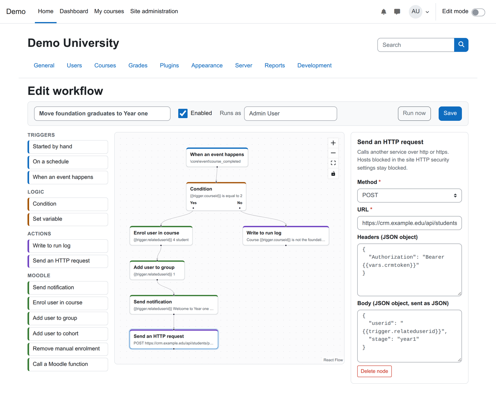
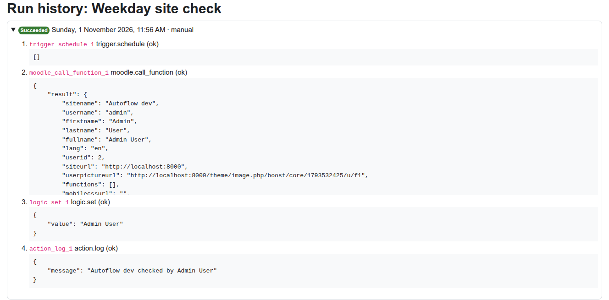

# Autoflow for Moodle (tool_autoflow)

[](https://github.com/devlms/moodle-tool_autoflow/actions/workflows/ci.yml)
[](https://devlms.github.io/moodle-tool_autoflow/)
[](https://devlms.github.io/moodle-tool_autoflow/e2e/)
[](https://devlms.github.io/moodle-tool_autoflow/php-coverage/)
[](https://devlms.github.io/moodle-tool_autoflow/php-mutation/)
[](https://devlms.github.io/moodle-tool_autoflow/js-coverage/)
[](https://devlms.github.io/moodle-tool_autoflow/js-mutation/)
[](https://moodledev.io/general/releases)
[](https://www.php.net/supported-versions.php)
[](LICENSE)

Build Moodle automations as workflows in a node editor, instead of writing a new plugin for every one.

> **Status: alpha.** Workflows can be built, saved and run, and every layer is tested. The node library is still small. Try it on a test site, not a production one.



## Why

Every school that runs Moodle has a list of small automations: email a student when they fall behind, enrol people when they finish a course, tell a teacher when a quiz closes. Today each one means a custom plugin, a code review and an upgrade to maintain.

Autoflow turns Moodle's own APIs into nodes. An administrator, or anyone with the right capability, wires them together in a [React Flow](https://reactflow.dev) editor, and Moodle runs the workflow from scheduled or ad hoc tasks. Think n8n, Zapier or Make, but inside Moodle, with Moodle's permissions and logs.

## What it does today

| Part | Status |
| --- | --- |
| Node editor (React Flow): palette, settings per node with required fields marked, branch handles, a one-line summary on each node, problems list | Done |
| Triggers: started by hand, on a schedule (cron, site timezone), when a Moodle event happens | Done |
| Logic: condition (Yes and No branches), set variable | Done |
| Actions: write to the run log, send an HTTP request to another service | Done |
| Moodle: send notification, enrol user in course, add user to group | Done |
| Moodle: call any web service function installed on the site (the Moodle API as one node), arguments as JSON | Done |
| Placeholders in any setting: `{{trigger.relateduserid}}`, `{{nodes.<id>.<key>}}`, `{{vars.<name>}}` | Done |
| Save-time checks: one trigger, no loops, nothing unconnected, valid cron and event, required settings filled. A workflow with problems is kept as a disabled draft | Done |
| Run history with each step's output or error | Done |
| Loop protection: a workflow that fires its own trigger stops after 3 levels | Done |
| Runs as the user who saved it last, or a user they pick if they hold `moodle/user:loginas` (only a site admin can pick a site admin) | Done |
| Privacy provider and capabilities | Done |
| More nodes: grades, course actions, cohorts, loops over lists | Planned |



## How a workflow runs

1. A trigger fires: the Run now button, the every-minute schedule task, or a Moodle event caught by one observer that does a single cached lookup and returns.
2. An ad hoc task is queued as the workflow's run-as user, so the work never happens inside someone's page request.
3. The engine walks the graph from the trigger. Each node gets its settings with placeholders filled in, and a condition picks which branch continues.
4. The run, with every step's output, is saved to the run history. A node that fails stops the run and records why.

## Safety

- **Permissions.** A workflow runs as the user who saved it last, unless they pick someone else. Picking another user needs `moodle/user:loginas`, the permission Moodle already uses for acting as someone, and only a site admin can pick a site admin, so a workflow can never be raised above the person who saves it. Every Moodle node goes through the same capability checks as Moodle's web services, so enrolling someone needs `enrol/manual:enrol`, adding to a group needs `moodle/course:managegroups`, and so on.
- **No code in placeholders.** Placeholder values are filled into each setting separately, never pasted into JSON text, so trigger data such as a user's name cannot add or change arguments.
- **HTTP requests** go through Moodle's own curl class, so the site's HTTP security settings (blocked hosts and allowed ports, which block local and private addresses by default) apply to the first URL and to every redirect. Only http and https, GET, POST, PUT, PATCH and DELETE. Requests time out after 15 seconds, follow at most 3 redirects, and keep at most 256 KB of the answer. Header names and values are checked so a placeholder cannot add a header of its own. An answer of 400 or more fails the step.
- **Events never slow a page.** One observer catches every event with a single cached lookup. The workflow runs later in an ad hoc task.
- **Loops stop.** A workflow whose own action fires its trigger again stops after 3 levels.

## How it is built

- **Admin tool** (`admin/tool/autoflow`). Managing workflows is a system capability (`tool/autoflow:manage`) with config, data loss, XSS and personal data risk, given to managers by default.
- **Engine** in `classes/local/engine`: plain PHP with no Moodle globals. That keeps it fast to test and lets mutation testing run thousands of times without booting Moodle.
- **Editor** in `frontend/`: React and React Flow, written in TypeScript, built by Vite into one script in `frontend/dist` that the plugin ships. React is bundled in, so it never clashes with the copy Moodle 5.2+ uses for its own components.
- Supports Moodle 4.5 LTS to 5.3 LTS, on PHP 8.1 to 8.4.

## Tests

Every push runs all of these. Reports and badge data are published to [devlms.github.io/moodle-tool_autoflow](https://devlms.github.io/moodle-tool_autoflow/).

| Layer | Tool | Where |
| --- | --- | --- |
| Moodle checks: lint, code style, PHPDoc, Mustache, Grunt, savepoints, validation | [moodle-plugin-ci](https://github.com/moodlehq/moodle-plugin-ci) | `.github/workflows/ci.yml` |
| PHP unit and integration tests, on every supported Moodle and PHP pairing | PHPUnit | `tests/` |
| PHP coverage | PHPUnit + pcov | Moodle 5.3 job |
| PHP mutation testing | [Infection](https://infection.github.io) | `infection.json5`, engine only |
| Behaviour tests in Moodle | Behat | `tests/behat/` |
| Editor unit and component tests, with coverage | Vitest + Testing Library | `frontend/test/` |
| Editor mutation testing | [Stryker](https://stryker-mutator.io) | `frontend/stryker.config.json` |
| End to end in a real browser | Playwright | `frontend/e2e/` |

Thresholds: Infection fails under 90% MSI, Stryker under 80%. The CI also fails if `frontend/dist` does not match a fresh build of `frontend/src`.

### Running them locally

Engine tests, coverage and mutation testing (Docker provides PHP with pcov):

```sh
composer install
vendor/bin/phpunit -c dev/phpunit.xml
dev/php vendor/bin/phpunit -c dev/phpunit.xml --coverage-text
dev/php vendor/bin/infection --threads=4
```

Editor:

```sh
cd frontend
npm ci
npm test                 # Vitest
npm run test:coverage
npm run test:mutation    # Stryker
npm run build            # rebuild frontend/dist, then commit it
```

Moodle PHPUnit, Behat and Playwright run against [moodle-docker](https://github.com/moodlehq/moodle-docker) with this plugin mounted at `admin/tool/autoflow`:

```sh
# in moodle-docker, with MOODLE_DOCKER_WWWROOT pointing at a Moodle checkout
bin/moodle-docker-compose exec webserver php admin/tool/phpunit/cli/init.php
bin/moodle-docker-compose exec webserver vendor/bin/phpunit --testsuite tool_autoflow_testsuite
bin/moodle-docker-compose exec webserver php admin/tool/behat/cli/init.php
bin/moodle-docker-compose exec -u www-data webserver php admin/tool/behat/cli/run.php --tags=@tool_autoflow
cd /path/to/moodle-tool_autoflow/frontend
MOODLE_URL=http://localhost:8000 MOODLE_ADMIN_PASS=... \
  MOODLE_CRON_CMD="cd /path/to/moodle-docker && bin/moodle-docker-compose exec -T webserver php admin/cli/adhoc_task.php --execute" \
  npx playwright test
```

## Contributing

Issues and pull requests are welcome. New code comes with tests, and the mutation scores should not drop.

## License

GNU GPL v3 or later. Built by [DevLMS](https://devlms.com).
